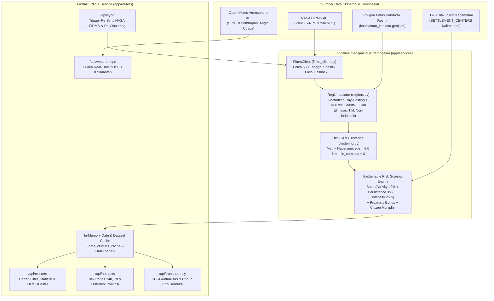

# PREVHUT — FIREZONE Data & Hazard Intelligence Service

[](https://fastapi.tiangolo.com/)
[](https://www.python.org/)
[](https://scikit-learn.org/)
[](https://pandas.pydata.org/)
[](https://prevhut-production.up.railway.app/docs)

> **Microservice Kecerdasan Geospasial, Pengelompokan Titik Panas Satelit NASA FIRMS (DBSCAN Haversine), Pemetaan Poligon Administrasi Kalimantan, serta Explainable Multi-Criteria Fire Risk Scoring untuk Platform FIREZONE.**

---

## Tautan Ekosistem Production & Dokumentasi API Live

| Layanan | Deskripsi | URL Production (Railway & GitHub) |
| :--- | :--- | :--- |
| **FastAPI Swagger UI (Repo Ini)** | Dokumentasi interaktif endpoint Data & AI Service | [https://prevhut-production.up.railway.app/docs](https://prevhut-production.up.railway.app/docs) |
| **FastAPI ReDoc (Repo Ini)** | Dokumentasi spesifikasi OpenAPI alternatif | [https://prevhut-production.up.railway.app/redoc](https://prevhut-production.up.railway.app/redoc) |
| **Core Backend Swagger UI (NestJS)** | Dokumentasi interaktif REST API Backend utama | [https://prevhutweb-production.up.railway.app/api/docs](https://prevhutweb-production.up.railway.app/api/docs) |
| **FIREZONE Web Application** | Aplikasi web publik, peta interaktif, dan posko BPBD | [https://firezone-production.up.railway.app](https://firezone-production.up.railway.app) |
| **Repositori Web & Core Backend** | Source code Frontend React 19 & Backend NestJS | [https://github.com/onyourjie/prevhut_web](https://github.com/onyourjie/prevhut_web) |

---

## Tentang PrevHut Data Service

**PrevHut** merupakan lapisan *Data Science & Geospatial Intelligence* pada platform **FIREZONE**. Layanan ini bertugas mengubah ribuan data mentah penginderaan jauh satelit menjadi informasi **Area Pantau Prioritas (P1, P2, P3)** yang dapat dijelaskan secara transparan (*Explainable AI/Risk Scoring*) dan siap ditindaklanjuti oleh masyarakat, relawan lapangan, maupun Admin Posko BPBD di seluruh Pulau Kalimantan (Kalimantan Barat, Kalimantan Tengah, Kalimantan Selatan, Kalimantan Timur, dan Kalimantan Utara).

Masalah utama pada pantauan titik panas mentah adalah jumlah titik yang terlalu masif dan tersebar tanpa konteks kedekatan permukiman atau tingkat keparahan. Repositori ini menyelesaikan masalah tersebut melalui:
1. **Akuisisi Langsung NASA FIRMS VIIRS 375m:** Penarikan data *Near Real-Time* (NRT) dari instrumen VIIRS Suomi-NPP beserta mekanisme *fallback* dataset lokal.
2. **Pemetaan Poligon Administrasi Presisi (*Point-in-Polygon*):** Penentuan Provinsi dan Kabupaten/Kota menggunakan algoritma *Vectorized Ray Casting* dan `KDTree` pesisir, sekaligus membuang titik di luar wilayah Indonesia (Sarawak, Sabah, Brunei).
3. **Spatio-Temporal DBSCAN Clustering:** Mengelompokkan titik panas aktif dalam radius Haversine 8 km menjadi kesatuan poligon **Area Pantau**.
4. **Explainable Multi-Criteria Risk Scoring:** Menggabungkan 3 parameter fisik satelit (kerapatan aktivitas, persistensi multi-hari di lahan gambut, dan energi radiasi termal FRP) dengan eksposur jarak ke permukiman terdekat serta validasi laporan warga lapangan.

---

## Arsitektur Pemrosesan Data & Alur Model



---

## Metodologi & Implementasi Algoritma Inti

### 1. Ingesti Data Satelit NASA FIRMS (`app/services/firms_client.py`)
* Mengambil data titik panas dari endpoint resmi NASA FIRMS (`VIIRS_SNPP_NRT`) menggunakan *bounding box* Pulau Kalimantan (`108.5,-4.5,119.2,4.5`).
* Mendukung kueri rentang 5 hari terakhir maupun penarikan spesifik per tanggal observasi (`YYYY-MM-DD`).
* Apabila jumlah titik pada tanggal terbaru terlalu sedikit (`< 100` titik akibat jeda orbit), sistem otomatis menggabungkan 2 tanggal observasi terbaru agar pemantauan tetap komprehensif.
* Dilengkapi *graceful fallback* ke berkas cache lokal (`hotspots_kalimantan_7d.csv`) jika API NASA sedang mengalami kendala jaringan atau limitasi kuota.

### 2. Reverse Geocoding Poligon Administrasi & KDTree Pesisir (`app/services/regions.py`)
Setiap titik koordinat `(latitude, longitude)` dipetakan secara eksak ke wilayah administrasi tempat titik tersebut berada menggunakan `kalimantan_kabkota.geojson`:
* **Vectorized Even-Odd Ray Casting (`_points_in_rings`):** Menguji ketercakupan titik di dalam cincin poligon (*outer ring* maupun *hole*) secara vektor dalam batch 2.048 titik untuk efisiensi memori dan kecepatan tinggi.
* **Penyaringan Batas Negara:** Karena *bounding box* Kalimantan turut mencakup sebagian wilayah Malaysia (Sarawak, Sabah) dan Brunei Darussalam, seluruh titik yang tidak jatuh di dalam poligon provinsi Indonesia otomatis dibuang (`df[df["province"].notna()]`).
* **Toleransi Garis Pantai (`KDTree`):** Mengingat poligon batas wilayah merupakan hasil generalisasi kartografis, titik panas yang berada di pesisir pantai atau muara sungai ditangani dengan struktur data `sklearn.neighbors.KDTree` menggunakan toleransi `COASTAL_TOLERANCE_DEG = 0.03` (~3,3 km).

### 3. Pengelompokan Spasial DBSCAN (`app/services/clustering.py`)
Titik-titik panas harian dikelompokkan menjadi area bahaya terpadu menggunakan algoritma *Density-Based Spatial Clustering of Applications with Noise* (`DBSCAN`):
* **Metrik Geodesik:** `metric='haversine'` dengan konversi koordinat ke satuan radian bumi (`R = 6371.0 km`).
* **Radius Kerapatan (`eps`):** `8.0 / 6371.0` radian (setara radius **8,0 km**).
* **Ambang Minimum (`min_samples`):** Minimal **3 titik panas** berdekatan untuk membentuk satu klaster Area Pantau (titik sporadis tunggal diklasifikasikan sebagai *noise* `-1`).
* **Geometri Output:** Menghitung koordinat *centroid* rata-rata, *bounding box* dengan penyangga visual `±0.015` derajat, daftar seluruh kabupaten yang tercakup (`kabupaten_list`), serta menyimpan hingga 30 titik panas dengan nilai *Fire Radiative Power* (FRP) tertinggi di dalam klaster.

### 4. Explainable Multi-Criteria Fire Risk Scoring (`app/services/clustering.py`)
Setiap klaster dinilai dalam rentang **0,0 hingga 100,0** melalui tiga lapis evaluasi:

#### A. Skor Dasar Satelit (`base_risk_score`)
1. **Activity Score (Bobot 40%):** Menilai kepadatan titik panas aktif 24 jam di dalam klaster:
   ```text
   norm_act = min(100.0, 30.0 + (min(count_daily, 50) / 10.0) * 14.0)
   ```
2. **Persistence Score (Bobot 35%):** Menilai kemunculan api berulang pada *bounding box* yang sama dalam riwayat 7 hari terakhir (indikator kuat kebakaran bawah permukaan di lahan gambut):
   ```text
   norm_pers = min(100.0, (days_detected / 4.0) * 100.0)
   ```
3. **Thermal Intensity Score (Bobot 25%):** Menilai daya energi radiasi termal (*Fire Radiative Power* dalam MW) menggunakan kombinasi median FRP dan 25% nilai puncak maksimum FRP:
   ```text
   effective_frp = max(median_frp, max_frp * 0.25)
   norm_int = min(100.0, (effective_frp / 50.0) * 100.0)
   ```
4. **Kalkulasi Base Score:**
   ```text
   base_score = round((0.40 * norm_act) + (0.35 * norm_pers) + (0.25 * norm_int), 1)
   ```

#### B. Faktor Eksposur & Kedekatan Permukiman (`proximity_urgency`)
Menghitung jarak Haversine terdekat dari *centroid* klaster ke 120+ titik pusat kecamatan di 5 provinsi Kalimantan (`SETTLEMENT_CENTERS`):
* **Jarak `< 3,0 km`:** Tambahan **+8,0 poin** — Status: *Kritis (< 3 km - Ancaman Langsung Permukiman)*.
* **Jarak `3,0 – 7,0 km`:** Tambahan **+4,0 poin** — Status: *Waspada (3 - 7 km - Bahaya Paparan Asap)*.
* **Jarak `> 7,0 km`:** Tambahan **+0,0 poin** — Status: *Pantauan Luar (> 7 km - Area Hutan/Gambut)*.

#### C. Fairness Crowd Urgency Multiplier (`citizen_urgency_boost`)
Mengintegrasikan laporan darurat warga di sekitar klaster (radius `<= 10,0 km`) dengan kurva *diminishing returns* guna mencegah manipulasi skor masif namun tetap responsif terhadap konfirmasi lapangan:
* **0 Laporan Warga:** `+0,0 poin`
* **1 Laporan Warga:** `+5,0 poin` (*Ground-truth verification / Dual-Confirmed*)
* **2 – 3 Laporan Warga:** `+10,0 poin` (*Konsensus warga sekitar*)
* **>= 4 Laporan Warga:** `min(15.0, 10.0 + (report_count - 3) * 1.0)` (Maksimal `+15,0 poin`)

#### D. Klasifikasi Tingkat Prioritas & Penjelasan Otomatis (`primary_factor`)
Skor akhir dihitung dengan rumus `final_score = min(100.0, round(base_score + proximity_urgency + citizen_boost, 1))` dan dikelompokkan menjadi:
* **P1 - Prioritas Tinggi:** `final_score >= 80.0`
* **P2 - Perhatian Meningkat:** `65.0 <= final_score < 80.0`
* **P3 - Waspada Ringan:** `final_score < 65.0`

Setiap klaster menyertakan atribut `primary_factor` yang menjelaskan alasan utama di balik skor tersebut (misal: *"Divalidasi langsung oleh 2 laporan warga sekitar (+10.0 Poin)"*, *"Titik api sangat dekat dengan permukiman warga (2.4 km)"*, atau *"Kerapatan deteksi tinggi (18 titik panas satelit)"*).

---

## Dokumentasi Endpoint REST API

Seluruh skema request dan response dapat diuji langsung melalui Swagger UI di [**https://prevhut-production.up.railway.app/docs**](https://prevhut-production.up.railway.app/docs).

### 1. Health & Service Info (`/`)
* `GET /` — Informasi status kesehatan microservice, versi aplikasi, dan indeks endpoint utama.

### 2. Klaster Area Pantau (`/api/clusters`)
* `GET /api/clusters` — Mengambil daftar Area Pantau hasil clustering DBSCAN yang telah diurutkan dari skor risiko tertinggi.
  * **Query Parameters:**
    * `priority` *(opsional)*: Filter tingkat prioritas (`P1`, `P2`, `P3`).
    * `province` *(opsional)*: Filter nama provinsi (misal: `Kalimantan Barat`).
    * `kabupaten` *(opsional)*: Filter nama kabupaten/kota (misal: `Kabupaten Sintang`).
    * `kecamatan` *(opsional)*: Filter nama kecamatan terdekat.
    * `min_score` *(opsional)*: Batas minimum skor risiko (`float`).
    * `date` *(opsional)*: Tanggal observasi satelit format `YYYY-MM-DD` (dilengkapi *in-memory caching* `< 10ms`).
* `GET /api/clusters/statistics` — Ringkasan jumlah total klaster, rincian jumlah klaster P1, P2, P3, dan total titik panas terklaster.
* `GET /api/clusters/{cluster_id}` — Detail spesifik satu Area Pantau berdasarkan ID (misal: `area_pantau_01`) beserta daftar koordinat titik panas penyusunnya.

### 3. Titik Panas Satelit NASA FIRMS (`/api/hotspots`)
* `GET /api/hotspots/live` (alias `GET /api/hotspots/24h`) — Mengambil titik panas mentah VIIRS 375m dalam 24 jam terakhir (mendukung filter `province`, `confidence`, dan `limit`).
* `GET /api/hotspots/7d` — Mengambil riwayat titik panas 7 hari terakhir untuk analisis tren temporal.
* `GET /api/hotspots/stats` — Rekapitulasi distribusi jumlah titik panas dan akumulasi daya radiasi termal (`total_frp_mw`) per provinsi di Kalimantan.

### 4. Observasi Cuaca & Kualitas Udara (`/api/weather-ispu`)
* `GET /api/weather-ispu` — Mengambil observasi cuaca *real-time* stasiun default (Kabupaten Sintang) atau berdasarkan parameter `city`.
* `GET /api/weather-ispu/{city}` — Mengambil data meteorologi langsung dari sensor atmosfer Open-Meteo untuk kota utama Kalimantan (`Sintang`, `Pontianak`, `Palangka Raya`, `Banjarmasin`, `Samarinda`), mencakup suhu udara (`temperature_c`), kelembapan relatif (`humidity_percent`), arah mata angin (`wind_direction`), dan deskripsi cuaca.

### 5. Laporan Komunitas (`/api/community`)
* `GET /api/community/reports` — Mengambil daftar laporan warga dengan dukungan filter `category` (`Darurat` / `Informasi`), `status`, dan kata kunci `search`.
* `GET /api/community/reports/{report_id}` — Mengambil detail laporan warga beserta riwayat pembaruan progres dan komentar.
* `POST /api/community/reports` — Menerima penerusan laporan warga baru dari Core Backend untuk diintegrasikan ke dalam kalkulasi *crowd urgency boost*.

### 6. Transparansi Publik & Open Data (`/api/transparency`)
* `GET /api/transparency/summary` — Mengambil metrik KPI akuntabilitas publik (total hotspot 24h/7d, jumlah klaster P1–P3, median waktu respon petugas, serta rasio penyelesaian laporan).
* `GET /api/transparency/download-csv` — Mengunduh dataset terbuka `fireline_priority_areas_kalimantan.csv` untuk kebutuhan riset akademis, jurnalisme data, dan masyarakat umum.

### 7. Sinkronisasi Langsung (`/api/sync`)
* `POST /api/sync` — Memicu penarikan data terbaru dari API NASA FIRMS secara langsung, menjalankan ulang pipeline DBSCAN + Risk Scoring, memperbarui `clusters_summary.json`, dan menyegarkan cache memori.

---

## Struktur Direktori Repositori

```text
prevhut/
├── README.md                                       # Dokumentasi utama repositori model & data service
├── data/
│   ├── raw/                                        # Dataset mentah hasil unduhan satelit & geospasial
│   └── processed/                                  # Hasil olahan clustering, GeoJSON batas wilayah, & CSV terbuka
├── notebooks/
│   └── prevhut_data_modeling.ipynb                 # Eksplorasi data (EDA), eksperimen DBSCAN, & validasi formula skor
├── scripts/                                        # Skrip utilitas pemrosesan data batch
└── fireline_data_service/                          # Root direktori FastAPI Microservice (Production Deployment)
    ├── requirements.txt                            # Dependensi Python (FastAPI, Uvicorn, Scikit-Learn, Pandas, dll.)
    ├── data/                                       # Bundled dataset produksi untuk deployment mandiri di Railway
    │   ├── clusters_summary.json                   # Ringkasan klaster Area Pantau Kalimantan
    │   ├── kalimantan_kabkota.geojson              # Poligon batas Kabupaten/Kota resmi se-Kalimantan
    │   ├── kalimantan_provinces.geojson            # Poligon batas Provinsi Kalimantan
    │   ├── hotspots_kalimantan_24h.json            # Cache titik panas 24 jam terakhir
    │   ├── hotspots_kalimantan_7d.csv              # Dataset fallback 7 hari terakhir
    │   ├── community_reports.json                  # Data laporan warga lapangan
    │   └── fireline_priority_areas_kalimantan.csv  # Dataset terbuka (Open Data CSV)
    └── app/
        ├── main.py                                 # Entrypoint FastAPI, konfigurasi CORS, & registrasi router
        ├── core/
        │   └── config.py                           # Konfigurasi environment Pydantic Settings & resolusi DATA_DIR
        ├── schemas/
        │   └── models.py                           # Skema validasi data Pydantic (ClusterItem, HotspotPoint, dll.)
        ├── services/
        │   ├── clustering.py                       # Engine DBSCAN Haversine 8km & Explainable Risk Scoring
        │   ├── firms_client.py                     # Klien HTTP asinkron NASA FIRMS VIIRS 375m & fallback
        │   ├── regions.py                          # Point-in-polygon ray casting & KDTree coastal locator
        │   └── data_loader.py                      # Singleton in-memory loader untuk dataset JSON/GeoJSON
        └── routers/
            ├── clusters.py                         # Endpoint /api/clusters
            ├── hotspots.py                         # Endpoint /api/hotspots
            ├── weather.py                          # Endpoint /api/weather-ispu
            ├── community.py                        # Endpoint /api/community
            ├── transparency.py                     # Endpoint /api/transparency
            └── sync.py                             # Endpoint /api/sync
```

---

## Panduan Menjalankan Secara Lokal

### 1. Prasyarat
* **Python** versi `3.11` atau lebih baru
* **pip** atau **uv** package manager

### 2. Instalasi & Menjalankan Server FastAPI
```bash
# 1. Clone repositori
git clone https://github.com/onyourjie/prevhut.git
cd prevhut/fireline_data_service

# 2. Buat dan aktifkan virtual environment
python3 -m venv venv
source venv/bin/activate  # macOS / Linux
# atau: venv\Scripts\activate  # Windows

# 3. Instal seluruh dependensi
pip install -r requirements.txt

# 4. (Opsional) Atur variabel lingkungan di file .env
# NASA_FIRMS_MAP_KEY=masukkan_map_key_nasa_firms_anda
# KALIMANTAN_BBOX=108.5,-4.5,119.2,4.5

# 5. Jalankan server FastAPI
uvicorn app.main:app --host 0.0.0.0 --port 8000 --reload
```

Setelah server aktif, akses:
* **Endpoint Root / Health Check:** `http://localhost:8000/`
* **Swagger UI Interaktif:** `http://localhost:8000/docs`
* **ReDoc:** `http://localhost:8000/redoc`

---

## Konfigurasi Deployment Production (Railway)

Service ini dideploy pada platform **Railway** dengan konfigurasi berikut:
* **Root Directory:** `/fireline_data_service`
* **Custom Start Command:** `uvicorn app.main:app --host 0.0.0.0 --port 8000`
* **Environment Variables:**
  * `NASA_FIRMS_MAP_KEY`: Kunci API resmi NASA FIRMS untuk penarikan data VIIRS SNPP NRT.
  * `KALIMANTAN_BBOX`: `108.5,-4.5,119.2,4.5`
  * `PORT`: `8000`

---

## Lisensi dan Integrasi

Dikembangkan sebagai bagian dari ekosistem **FIREZONE** (WIA MIA 2026) untuk peringatan dini bahaya kebakaran hutan dan lahan serta transparansi penanganan darurat berbasis komunitas.

* **Repositori Model & Data Microservice:** [https://github.com/onyourjie/prevhut](https://github.com/onyourjie/prevhut)
* **Repositori Aplikasi Web & Core Backend:** [https://github.com/onyourjie/prevhut_web](https://github.com/onyourjie/prevhut_web)

